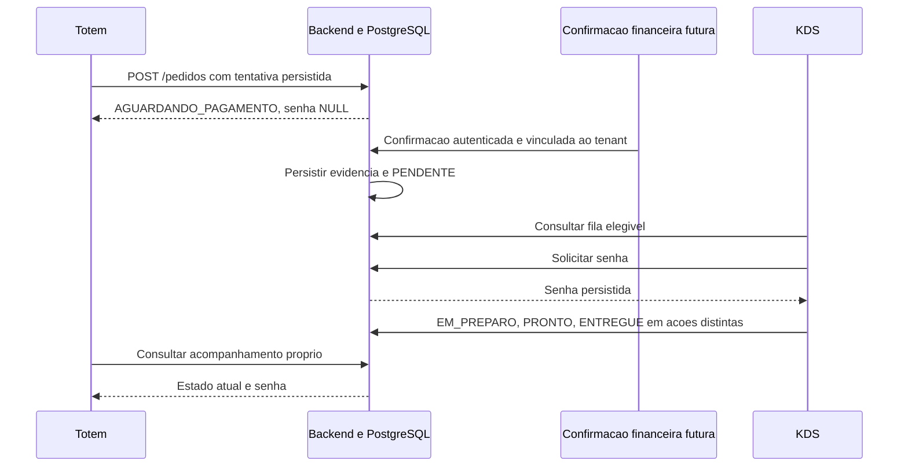
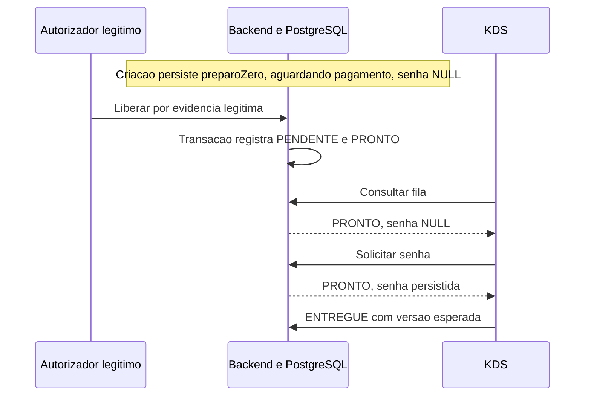
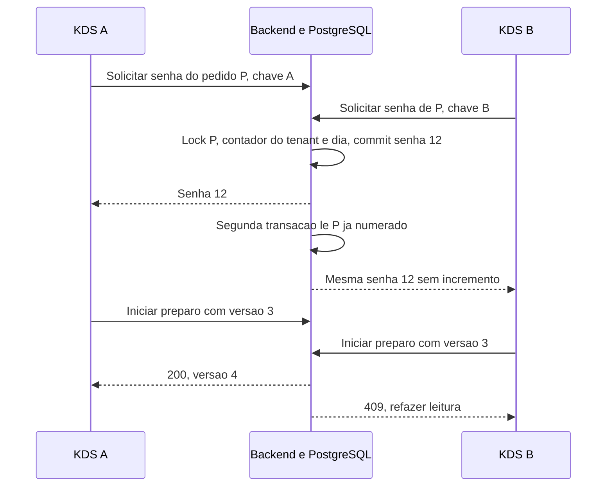
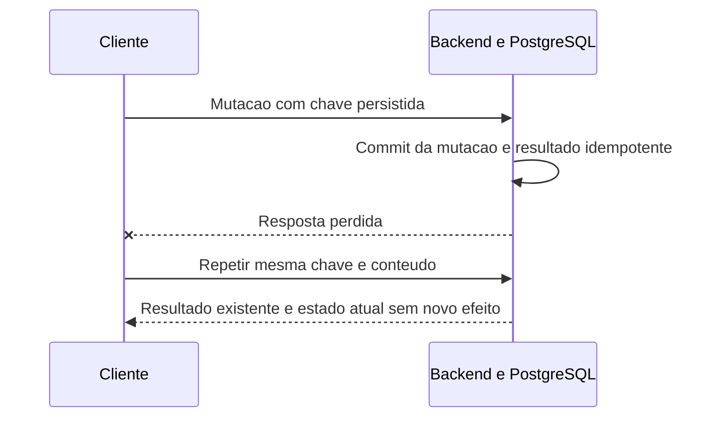

# ADR 0001: produção, senha, pagamento e modo DEMO no P0

Status: **PROPOSTA**, aguardando revisão do Caio. Data: 29/10/2026.
Responsável pela redação: Gabriel. Card [#28](https://trello.com/c/T6hZ5Npz).

Atualização incremental #29: implementação da liberação DEMO autorizada pelo
usuário após o merge documental #14 e submetida a PR próprio. Ver
[comportamento efetivo, configuração e limites](../liberacao-demo.md).
A auditoria abaixo permanece a fotografia da base ef20663; a implementação
incremental não representa aprovação do Caio das demais decisões desta ADR.

Esta ADR não autoriza implementar exceções às regras globais. As alterações
recomendadas para aprovação estão na [matriz de divergências](../contrato-operacional-divergencias.md).
Contratos HTTP detalhados: [propostas P0](../contrato-operacional-http-p0.md).

## 1. Contexto, fontes e grau de certeza

Auditoria sobre `origin/develop` no commit
`ef20663a923d487ad9ec8cd268e5fd0d52ce49b7`, integração do
[PR #13](https://github.com/GabrielNito/TotemOS/pull/13).
Foram lidos o card #28, suas dependências e o
[roadmap #27](https://trello.com/c/iKSJ1R4J), incluindo os comentários do
[spike #19](https://trello.com/c/Bg3wiyyw). Documentação histórica não comprova
implementação. Esta auditoria não acessou o banco operacional nem verificou deploy.

| Classificação | Significado e evidência                                                                                                                                  |
| ------------- | -------------------------------------------------------------------------------------------------------------------------------------------------------- |
| IMPLEMENTADO  | Comprovado no código da base auditada, com limites descritos abaixo. Não significa homologado em produção.                                               |
| DECIDIDO      | Regra global ou direção já registrada no card/roadmap: tenant, snapshots, PIN, início aguardando pagamento e P0 cloud-online com PostgreSQL persistente. |
| PROPOSTO      | Contratos desta ADR, inclusive DEMO, transições, data operacional e numeração online. Equivale a PLANEJADO no card, até revisão humana.                  |
| INCONCLUSIVO  | Viabilidade não validada. LAN Android ↔ Android e numeração offline não sustentam o P0.                                                                  |

### Estado comprovado

- [Schema real](../../apps/backend/prisma/schema.prisma): os sete valores de
  `StatusPedido` já existem; `senha Int?`, `preparoZero Boolean`,
  `@@unique([negocioId, dataSequencial, senha])`, `idempotencyKey String? @unique`.
  `StatusPagamento` contém apenas `PENDENTE`, `APROVADO`, `RECUSADO`, `ESTORNADO`.
  Nenhum campo DEMO, versão de pedido, contador operacional ou auditoria de
  liberação está modelado.
- [Controller](../../apps/backend/src/pedidos/pedidos.controller.ts): apenas
  `POST /pedidos`, `GET /pedidos`, `GET /pedidos/:id`. POST aceita USER ou
  DEVICE/TOTEM; GET aceita USER ou DEVICE/PAINEL, rejeitando TOTEM. O
  [DeviceTypeGuard](../../apps/backend/src/auth/guards/device-type.guard.ts)
  permite USER sem restringir papel nessas rotas. A futura autorização de
  mutações precisa ser explícita.
- [Service](../../apps/backend/src/pedidos/pedidos.service.ts): deriva tenant da
  identidade recebida pelo controller; consulta catálogo com escopo de tenant,
  calcula snapshots e total, grava `AGUARDANDO_PAGAMENTO`, `senha: null`,
  `origemOffline: false` e `preparoZero`. A data atual é UTC na criação,
  `new Date().toISOString().slice(0, 10)`. Não há atribuição de senha.
- A listagem atual permite qualquer status ou ausência de filtro. **Não é uma
  fila com elegibilidade garantida pelo backend.** O detalhe inclui pagamentos.
  Não liberar esse retorno completo ao TOTEM para resolver acompanhamento.
- Replay sequencial procura `(negocioId, idempotencyKey)` e retorna o pedido
  existente. A chave é opcional, o header prevalece sobre o body, não há hash do
  payload, vínculo do replay ao dispositivo criador ou tratamento explícito da
  corrida de criação/violação de unicidade. Não há garantia auditada de replay
  concorrente; chave de outro tenant não recupera seu pedido, mas pode colidir no
  índice global. Esses pontos exigem cobertura no #39.
- [Testes de pedidos](../../apps/backend/test/pedidos.spec.ts) e
  [pedido real](../../apps/backend/test/pedido-real.spec.ts) verificam snapshots,
  tenant, senha nula, flag de preparo zero e replay com mocks. Não comprovam
  transições, locks ou concorrência de dois KDS em PostgreSQL real.
- [Guards](../../apps/backend/src/auth/guards/) e
  [decorators](../../apps/backend/src/auth/decorators/): USER é JWT humano com
  DONO/GERENTE; DEVICE usa token opaco validado por hash HMAC, dispositivo ativo
  e não revogado, com TOTEM/PAINEL. A consulta de credencial descobre o tenant;
  operações de domínio posteriores precisam sempre filtrar esse tenant.
- [AuthService](../../apps/backend/src/auth/auth.service.ts) valida PIN via
  bcrypt e comparação de tenant. `POST /auth/validar-pin` retorna `{valido:true}`;
  isso não é um comprovante transferível de autorização para outra requisição.
- [Envio do Totem](../../apps/totem/src/catalogo/order-submission.ts) e
  [integração](../../apps/totem/src/catalogo/order-api.ts): tentativa e payload
  persistidos antes da rede em SecureStore; recuperação com a mesma chave,
  bloqueio de outra venda enquanto incerto/pendente. Valida somente resposta
  `AGUARDANDO_PAGAMENTO`. Acompanhar estados posteriores exige #33.
- O [KDS](../../apps/kds/src/app/pedidos.tsx) é placeholder. Não há módulo
  produtivo de pagamentos, webhook, DEMO, transições, senha ou reconciliação no
  [AppModule](../../apps/backend/src/app.module.ts). Enums e nomes de rotas nas
  SPECs não constituem implementação desses recursos.
- O [relatório do PR #13](../totem-pedido-real.md) e suas
  [evidências](../evidence/totem-pedido-real/README.md) relatam testes em schema
  isolado e A54. O card #26 registra aplicação operacional da migração nullable
  em 29/10/2026 às 15:29 BRT; o texto original do PR antecede essa aplicação.
  É registro externo, não inspeção do banco nesta entrega.
- O [spike LAN](../spikes/kds-local-network.md) permanece INCONCLUSIVO:
  Android ↔ Android não confirmado e lacunas de WebSocket/mDNS. Código diagnóstico
  e comparação de `negocioId` fictício não são autenticação produtiva.
- `docs/regras-de-negocio-totem.md`, `docs/stack-detalhada-v1.md`,
  `docs/backend-modelo-e-rotas.md` e `docs/frontend-dashboard-nextjs.md` não
  existem na base auditada. Não foi possível ler seu conteúdo ou inferir regras.

## 2. Limite operacional e financeiro

DECIDIDO pelo roadmap: P0 online, backend cloud e PostgreSQL como fonte
persistente de verdade. Sem internet, preservar tentativa e informar estado
incerto; não liberar cozinha, emitir senha local ou fingir pagamento.
P0 demonstra o ciclo real de pedidos com autorização DEMO em ambiente isolado.
Simulador financeiro é P2; Point física, LAN e offline são pós-MVP.

PROPOSTO: separar os conceitos sem alterar enums/schema neste card:

| Dimensão                | Interpretação                                                                                                                                                                          |
| ----------------------- | -------------------------------------------------------------------------------------------------------------------------------------------------------------------------------------- |
| Operacional             | `AGUARDANDO_PAGAMENTO` retido; `PENDENTE` apto aguardando preparo; `EM_PREPARO` em execução; `PRONTO` aguardando entrega; `ENTREGUE` finalizado; estados cancelados removidos da fila. |
| Financeira              | Ausência de pagamento não equivale a aprovação. `Pagamento.status` registra somente fatos financeiros. Recusa não cancela automaticamente o pedido; estorno não reabre produção.       |
| Autorização operacional | Evidência financeira legítima futura ou autorização DEMO persistida e auditada. DEMO nunca equivale a `Pagamento.APROVADO`.                                                            |

`CANCELADO_AGUARDANDO_ESTORNO` é um estado legado que cruza as dimensões:
operação encerrada, obrigação financeira aberta. Mantê-lo sem criar enum
alternativo. Nomes conceituais ou campos de exemplo desta ADR não são novos
valores Prisma. Não criar pagamento com valor zero para encenar aprovação.

Invariantes: tenant vem da credencial verificada; toda leitura/mutação de
domínio filtra `negocioId`, inclusive relações, auditoria, replay e contador.
Totais históricos vêm de `precoNoMomento`/`deltaNoMomento`; transições, replays
e liberação jamais recalculam pelo catálogo atual. PIN bcrypt, credenciais
humanas e de dispositivo permanecem distintos. Não registrar PIN/token em logs.

## 3. Elegibilidade e matriz de transições proposta

O backend calcula elegibilidade; filtro enviado pelo cliente não concede acesso.
Fila operacional contém apenas `PENDENTE`, `EM_PREPARO`, `PRONTO` com evidência
de autorização. Pedido novo nasce `AGUARDANDO_PAGAMENTO`, senha NULL, inclusive
Preparo Zero. Atribuir senha não aprova nem libera pedido.

Liberação legítima leva a `PENDENTE`. Se o `preparoZero` persistido na criação
for verdadeiro, executar também `PENDENTE → PRONTO` na mesma transação, com
registro das duas transições; o estado visível após commit é `PRONTO`.
Não consultar tempos atuais do catálogo para decidir novamente. Pedidos antigos
sem evidência confiável da classificação exigem revisão, não inferência de preço
ou liberação automática. KDS solicita senha também para PRONTO com preparo zero.

Todas as linhas abaixo são PROPOSTAS. `K` significa DEVICE/PAINEL ativo ou
USER/DONO/GERENTE explicitamente autorizado para preparo. `D` significa
USER/DONO com PIN validado na própria ação. Webhook/provedor financeiro é futuro,
nunca um token de Totem. Cancelamento e estorno não integram #29/#30/#31.

| Origem → destino                                          | Ator                                                 | Pré-condições                                                                           | Repetição                                                         | Erros esperados                                                         | Efeitos atômicos                                                                 |
| --------------------------------------------------------- | ---------------------------------------------------- | --------------------------------------------------------------------------------------- | ----------------------------------------------------------------- | ----------------------------------------------------------------------- | -------------------------------------------------------------------------------- |
| Criação → AGUARDANDO_PAGAMENTO                            | TOTEM ou USER, como hoje                             | Catálogo/tenant/quantidades válidos                                                     | Replay existente retorna pedido; endurecimento futuro conforme §6 | 400/401/403/404; corrida atual sem contrato específico                  | Snapshots, total e preparoZero; senha NULL; sem pagamento criado                 |
| AGUARDANDO_PAGAMENTO → PENDENTE                           | D em DEMO; futuro processador financeiro autenticado | DEMO marcado na criação e ambiente permitido; ou confirmação financeira legítima futura | Mesma operação retorna resultado persistido; nunca nova liberação | 401/403/404/409/429                                                     | Evidência de autorização, auditoria, versão; sem senha; DEMO não grava pagamento |
| PENDENTE → PRONTO                                         | Backend automático                                   | Liberação válida e preparoZero=true                                                     | Uma única consequência da liberação, sem novo evento lógico       | 409 se acionado manualmente/sem pré-condição                            | Segundo registro de transição na mesma transação da liberação                    |
| PENDENTE → EM_PREPARO                                     | K                                                    | Elegível, preparoZero=false, senha atribuída, versão esperada                           | Replay da ação, sem novo efeito                                   | 401/403/404/409                                                         | Status, versão, ator e instante                                                  |
| EM_PREPARO → PRONTO                                       | K                                                    | Mesma autorização, senha atribuída, versão esperada                                     | Replay da ação                                                    | 401/403/404/409                                                         | Status, versão e auditoria                                                       |
| PRONTO → ENTREGUE                                         | K                                                    | Senha atribuída, versão esperada                                                        | Replay da ação                                                    | 401/403/404/409                                                         | Status final, versão e auditoria; sai da fila                                    |
| AGUARDANDO_PAGAMENTO → CANCELADO                          | D, contrato futuro                                   | Nenhum valor recebido; se cobrança em curso, resolver seu resultado antes               | Replay sem novo cancelamento                                      | 401/403/404/409/429                                                     | Fecha operação sem estorno; senha continua NULL                                  |
| PENDENTE/EM_PREPARO/PRONTO → CANCELADO                    | D, contrato futuro                                   | DEMO sem transação financeira, ou ausência de obrigação comprovada                      | Replay sem novos efeitos                                          | 401/403/404/409/429                                                     | Sai da fila; preserva senha e histórico; DEMO sem estorno                        |
| PENDENTE/EM_PREPARO/PRONTO → CANCELADO_AGUARDANDO_ESTORNO | D, futuro financeiro                                 | Valor real recebido e obrigação de estorno identificada                                 | Mesma solicitação não repete estorno                              | 401/403/404/409/429; indisponibilidade do provedor não autoriza sucesso | Fecha operação e registra obrigação; não marca ESTORNADO antecipadamente         |
| CANCELADO_AGUARDANDO_ESTORNO → CANCELADO                  | D com PIN e evidência financeira, futuro             | Estorno confirmado, vinculado à cobrança correta e ao tenant                            | Replay sem novo estorno                                           | 401/403/404/409/429                                                     | Registra confirmação/ESTORNADO e encerra obrigação                               |
| Qualquer outra mudança                                    | Nenhum                                               | Não permitida                                                                           | Sem efeito                                                        | 409 para mudança inválida; 400 para formato/enum desconhecido           | Nenhum                                                                           |

ENTREGUE e CANCELADO são terminais no P0. Ajustes financeiros após entrega,
aprovação tardia após cancelamento e expiração de cobrança exigem contrato P2;
nunca ressuscitar pedido ou descartá-los como aprovados. Cancelamentos futuros
devem serializar com callbacks e mutações no mesmo pedido. Mesa autorizando
preparo antes de pagar é P1 (#44/#47), sem exceção implícita no P0.

## 4. Contrato DEMO proposto

1. Ambiente servidor explicitamente `demo` ou `test`, habilitação DEMO explícita
   e allowlist de negócios de demonstração. Valores ausentes/desconhecidos
   desabilitam a ação. Qualquer classificação do deploy como produção veta
   DEMO mesmo com flag ligada. Não depender somente de `NODE_ENV`, parâmetro
   de URL, configuração do app ou valor enviado pelo Totem.
2. Banco/credenciais isolados da operação comercial e verificação dessa
   configuração no provisionamento (#41). Backend marca o pedido como DEMO
   **na criação**, pela configuração confiável do ambiente/tenant. Nenhum body
   flag pode criar, converter ou liberar pedido real. Pedidos anteriores sem
   marca não podem ser convertidos. Esse marcador requer modelagem futura #29.
3. Somente humano USER/DONO pode liberar, com sessão e vínculo ao negócio
   revalidados, PIN bcrypt na própria ação, motivo e chave de idempotência.
   GERENTE, PAINEL e TOTEM recebem 403, mesmo que forneçam PIN ou `aprovado:true`.
   Aplicar limite de cinco tentativas por minuto na ação sensível.
4. Persistir marca imutável, autorização, ator, tenant, instante do servidor,
   motivo, chave/hash da requisição e histórico anterior/posterior. Liberação,
   transições automáticas e auditoria pertencem ao mesmo commit. Se qualquer
   gravação falhar, rollback; sem liberação parcial ou apenas em memória.
5. Não criar/atualizar `Pagamento` para APROVADO, não chamar Point e não emitir
   comprovante de pagamento. Pedidos DEMO não entram em faturamento ou métricas
   comerciais; contagens operacionais DEMO devem ser identificadas separadamente.
   Todas as telas/retornos futuros de acompanhamento e fila exibem DEMO.
6. Liberação preserva snapshots e total demonstrativo. Recusar pedido com
   qualquer tentativa financeira vinculada (409), estado incompatível, ambiente
   inválido ou ausência de marcador. O P0 não oferece conversão DEMO → REAL.
7. Reinício restaura o fato persistido; não exige nova autorização para a mesma
   operação já concluída e não refaz a liberação. Toda requisição ainda autentica
   e verifica ambiente antes de consultar replay. Desabilitar a configuração
   bloqueia novas liberações e mutações DEMO; não apaga fatos nem os converte.
8. Repetir a mesma chave/conteúdo retorna sucesso existente, mesmo se o pedido
   já avançou; não regride para PENDENTE. Outra chave para pedido já liberado
   recebe 409. Mesmo UUID com outro conteúdo recebe 409. Cancelamento futuro
   encerra DEMO sem estorno e mantém marca/auditoria; não excluir para permitir
   nova liberação. Criar outro pedido requer outra tentativa explícita.

É liberação operacional, não simulador financeiro. A prévia local Brioche é
uma interface demonstrativa independente, sem a persistência/autorização deste
contrato. Não apresentá-la como mecanismo #29 implementado.

## 5. Senha online: período, concorrência e recuperação

PROPOSTO: KDS inicia solicitação; backend atribui e persiste atomicamente.
Não aceitar número calculado pelo cliente. TOTEM só exibe retorno do servidor.
Dois KDS são clientes equivalentes do mesmo contador transacional.

Período P0: dia civil `[00:00:00, 00:00:00 do dia seguinte)` no fuso IANA
`America/Sao_Paulo`, pela data do relógio PostgreSQL **na primeira atribuição**,
amostrada após adquirir o lock do pedido. Armazenar o instante em UTC e a data
local `YYYY-MM-DD`; nunca usar relógio do Android ou offset fixo. Não há reset
manual por sessão no P0. Iniciar em 1 por tenant/data; não reciclar senhas de
cancelados, não usar módulo 999 e não prometer ausência de lacunas.

Pedido criado antes da meia-noite e numerado depois recebe data do novo dia.
Replay depois da meia-noite conserva data e senha originais. Enquanto senha
for NULL, a data UTC gravada hoje na criação não define o período definitivo;
#31 deverá ajustar `dataSequencial` na primeira atribuição e revisar filtros.
Pedidos abertos do dia anterior continuam na fila até saída legítima; exibir
data junto da senha quando necessário para distinguir números de dias distintos.
Nunca renumerar registros históricos ou pedidos já numerados nesta entrega.

### Alternativas

| Alternativa                                                                   | Avaliação proposta                                                                                                                                                                  |
| ----------------------------------------------------------------------------- | ----------------------------------------------------------------------------------------------------------------------------------------------------------------------------------- |
| Contador por `(negocioId, dataOperacional)` com lock e índice único no pedido | Preferida. Incremento e vínculo ao pedido no mesmo commit; serialização só do período daquele tenant. Requer modelagem/migração em #31.                                             |
| Lock da linha do Negocio + MAX(senha)+1 + índice único                        | Alternativa mínima sem tabela de contador. Todas as emissões do negócio precisam obter esse mesmo lock; maior contenção e leitura do histórico. MAX sozinho, sem lock, é incorreto. |
| MAX+1 com índice único e retry; ou isolamento serializable                    | Pode detectar colisões, mas exige reexecução completa e limite de tentativas; índice sozinho não define replay ou período. Não é a preferência P0.                                  |
| Contador local KDS, sequence global ou lock de sessão                         | Contador local não coordena dois KDS. Sequence global não atende escopo por dia/tenant. Lock de sessão não deve depender de conexão persistente através do pooler.                  |

Algoritmo conceitual preferido, sem SQL executável ou implementação neste card:

1. Autenticar PAINEL, derivar tenant e iniciar transação. Bloquear linha do pedido
   com filtro `(negocioId, id)`. Se já numerado, retornar
   a mesma senha/data, sem incrementar, inclusive se já entregue/cancelado.
2. Se ainda sem senha, aceitar somente PENDENTE/EM_PREPARO/PRONTO elegível.
   Amostrar instante/data no banco, criar contador ausente com conflito tratado
   na chave `(negocioId, data)` e obter seu lock. A inexistência de uma linha
   não pode ser protegida apenas por SELECT FOR UPDATE.
3. Incrementar contador, atualizar senha/data do pedido ainda com senha NULL,
   incrementar versão e gravar auditoria/idempotência. Preservar o índice único
   existente em `(negocioId, dataSequencial, senha)` como última barreira.
4. Commit antes de responder. Todos os emissores seguem ordem pedido → contador;
   nenhuma chamada externa dentro da transação. Cancelamento e liberação usam o
   mesmo lock do pedido. Futuras migrações devem inicializar contadores a partir
   do histórico existente por período, sem renumerar ou reiniciar em 1 cegamente.
5. Rollback desfaz incremento e atribuição. Deadlock/serialização/conflito de
   inicialização exigem retry da transação inteira, até três tentativas com
   jitter; depois 503 com Retry-After, sem senha inventada ou mensagem de sucesso.
   Colisão com histórico exige diagnóstico do contador; não remover índice.
6. Resposta perdida após commit: cliente repete chave e pedido. Leitura do
   registro persistido devolve mesma senha; reinício de backend/KDS não altera
   contador. Se sem commit, retry pode concluir primeira atribuição.

Fundamentos consultados: locks de linha duram até o fim da transação e
transações podem sofrer deadlock ([PostgreSQL: locks](https://www.postgresql.org/docs/18/explicit-locking.html)).
UPSERT pode coordenar a criação/incremento da linha do contador
([PostgreSQL: INSERT](https://www.postgresql.org/docs/18/sql-insert.html)).
O índice composto impede números repetidos no período; NULLs continuam permitidos
em pedidos não numerados ([PostgreSQL: constraints](https://www.postgresql.org/docs/18/ddl-constraints.html)).
O algoritmo é uma proposta de aplicação desses mecanismos, a validar no #39;
não afirma a versão do PostgreSQL operacional nem homologação no Neon.

Numeração offline futura permanece INCONCLUSIVA e separada. Aceitar senha local
em reconciliação exigirá protocolo de autoridade/conflitos próprio; este contrato
online não comprova nem implementa a regra histórica de sincronização offline.

## 6. Consistência, idempotência e atualização dos clientes

As mutações novas exigem `Idempotency-Key` UUID persistida pelo cliente antes da
rede. Escopo proposto: tenant + principal autenticado + operação + chave;
registrar pedido e hash canônico do payload, excluindo PIN e credenciais. Não
usar chave como autorização. Consulta de replay acontece após autenticação,
checagem de tenant e políticas de ambiente. Mesma chave com outro conteúdo ou
pedido: 409. Retenção do resultado acompanha o histórico do pedido no P0;
não expirar o registro e permitir reexecução silenciosa.

Serializar mutação e auditoria em PostgreSQL. Campo conceitual `versao` é
inteiro monotônico a modelar futuramente, não `updatedAt` usado como se fosse
contador. Ações de preparo enviam `versaoEsperada`; duas ações concorrentes com
mesma versão têm um vencedor, outra recebe 409 e refaz leitura. Replay da chave
vencedora retorna seu resultado lógico e o estado atual, sem reexecutar ou
retroceder. Senha é adicionalmente idempotente por pedido, mesmo entre KDS com
chaves distintas. Somente a primeira atribuição altera versão.

PROPOSTO: revalidar vínculo humano/dispositivo ativo na transação das novas
mutações. Revogação já confirmada impede nova ação (401 para deviceToken);
revogação concorrente e ação devem ter ordem serial definida, sem invalidar
retroativamente commits anteriores. Se usar locks de credencial, todos os
fluxos seguem credencial → pedido → contador, inclusive revogação e replay.
Essa garantia ainda não é fornecida apenas pelo guard atual e deve ser testada
no #39. Erros 400 também abrangem destinos fora do DTO da rota; pares de estados
conhecidos mas incompatíveis com origem/versão retornam 409.

P0 usa polling/refetch autenticado: proposta de intervalo de 3 s em primeiro
plano, sem chamadas sobrepostas, refetch ao voltar ao app/reconectar e após
mutação ou 409. Em falhas, backoff 3/6/12/24/30 s com jitter; respeitar
Retry-After em 429/503. 401 exige recuperar sessão; 403 não gera retry infinito.
Dados em cache são identificados como desatualizados e ações ficam indisponíveis
sem conexão. Eventos push/WebSocket não são dependência nem estão implementados;
se adicionados depois, serão aviso para refetch após commit. Não prometer entrega
única de notificação ou tempo real absoluto.

## 7. Sequências propostas e falhas

Os caminhos de pagamento real abaixo explicam o contrato futuro; o P0 utiliza
a autorização DEMO da sequência 3. Somente criação é implementada atualmente.

### 1. Pedido comum



### 2. Todos os itens Preparo Zero



### 3. Liberação DEMO

```mermaid
sequenceDiagram
    participant T as Totem
    participant D as Humano DONO
    participant B as Backend em ambiente DEMO isolado
    participant K as KDS
    T->>B: Criar pedido sem flag de aprovacao
    B->>B: Marcar DEMO pela configuracao do servidor
    B-->>T: AGUARDANDO_PAGAMENTO, senha NULL, identificacao DEMO
    D->>B: Liberar com JWT, PIN, motivo e chave
    B->>B: Validar ambiente, tenant e marca; commit com auditoria
    Note over B: Nenhum Pagamento APROVADO criado
    B-->>D: PENDENTE ou PRONTO se preparoZero
    K->>B: Consultar fila e solicitar senha
    B-->>K: Pedido DEMO elegivel e numerado
```

### 4. Dois KDS concorrentes



Para pedidos distintos no mesmo período, o contador serializa números distintos.
Para tenants distintos, contadores independentes podem emitir o mesmo número.

### 5. Resposta perdida após commit



Criação atual cobre replay sequencial; corrida/hash ainda são gaps (§1). Não
gerar nova chave por timeout. Se outro KDS avançou, exibir estado atual.

### 6. Reinício do Totem ou KDS

Totem restaura tentativa/resultado antes de aceitar compra; sem ID, recupera
criação pela mesma chave/payload; com ID, consulta acompanhamento próprio. KDS
restaura identidade, refaz fila e recupera resultado de ação incerta pela chave
persistida. Senha vem do banco. Perda de armazenamento/novo pareamento não
autoriza buscar todos os pedidos do tenant ou reenviar venda com chave nova;
exige recuperação assistida. #33 só limpa tentativa/carrinho e permite nova
venda após observar ENTREGUE/CANCELADO confirmado ou descarte autorizado com
contrato próprio. CANCELADO_AGUARDANDO_ESTORNO não é descarte no P0.

### 7. Pedido de outro tenant

Credencial válida de A solicita ID de B. Backend consulta com ID **e tenant A**,
retorna 404, sem revelar existência, senha, pagamento ou replay de B. Credencial
inválida/revogada recebe 401 antes da consulta de domínio. TOTEM de outro
dispositivo no mesmo tenant também recebe 404 no acompanhamento restrito.

### 8. Transição inválida

TOTEM tenta preparar: 403. PAINEL tenta AGUARDANDO_PAGAMENTO → EM_PREPARO ou
PENDENTE → ENTREGUE: 409. Estado desconhecido: 400. Estado/versão mudou no outro
KDS: 409 e refetch; sem nova tentativa automática de ação diferente. Backend
preserva snapshots, senha, pagamento e estado anterior quando rejeita.

## 8. Desdobramento dos cards

Nada abaixo foi implementado nesta entrega. Ordem: revisão #28, backend
#29/#30/#31 com contratos compatíveis, consumidores #23/#32/#33 e QA #39.

| Card e responsável                                           | Implementação posterior e evidência exigida                                                                                                                                                                                                                                             |
| ------------------------------------------------------------ | --------------------------------------------------------------------------------------------------------------------------------------------------------------------------------------------------------------------------------------------------------------------------------------- |
| [#29 DEMO, Caio](https://trello.com/c/XrQjjKto)              | Modelar marca/autorização/auditoria, aplicar gates do servidor e DONO/PIN, atomicidade e replay, identificar retornos DEMO; provar que não cria pagamentos nem libera pedido real.                                                                                                      |
| [#30 transições, Caio](https://trello.com/c/2InAb3Ob)        | Fila com elegibilidade no servidor, autorização explícita PAINEL/USER, versão, transições/Preparo Zero e acompanhamento mínimo seguro para #33. Não delegar filtro financeiro ao KDS.                                                                                                   |
| [#31 senha, Caio](https://trello.com/c/oIgJMdHX)             | Escolher estratégia transacional após revisão, modelar contador, definir data local na atribuição, preservar índice/histórico e replay por pedido; testes com dois KDS e virada do dia.                                                                                                 |
| [#23 fila KDS, Gabriel](https://trello.com/c/hZNzXBfQ)       | Substituir placeholder, consumir fila, solicitar senha inclusive Preparo Zero, operar preparo/entrega com versão, exibir DEMO e falhas; sem contador local/cancelamento financeiro.                                                                                                     |
| [#32 dois painéis, Gabriel](https://trello.com/c/QFo6ttWE)   | Polling/refetch, backoff, persistência de ações incertas, conflito 409 e invalidação visual; evidência com dois Androids quando disponíveis, sem presumir LAN.                                                                                                                          |
| [#33 acompanhamento, Gabriel](https://trello.com/c/kuhb9Ehh) | Consumir consulta restrita ao Totem criador, aceitar estados posteriores na validação de resposta, mostrar senha/DEMO sem mensagem de pago, recuperar reinício e habilitar próxima venda com critério terminal.                                                                         |
| [#39 QA, Caio](https://trello.com/c/fcNvIDEV)                | PostgreSQL isolado/CI: criação simultânea/replay/hash, duas credenciais KDS no mesmo e em distintos pedidos, tenants, revogação, DEMO em produção negado, zero pagamentos fictícios, Preparo Zero, meia-noite, locks/rollback, resposta perdida e reinício. Não usar banco operacional. |

O acompanhamento do Totem não tem card backend próprio no conjunto consultado:
propõe-se incluí-lo em #30 antes de #33, sujeito à confirmação do Caio. O mesmo
vale para endurecer a idempotência da criação: #39 identifica regressões e uma
correção backend revisada deve preceder homologação; não assumir cobertura atual.

## 9. Decisões para revisão humana antes de implementar

- Caio: aprovar exceção DEMO à regra global 3 e texto recomendado, mantendo
  veto em produção, marca na criação, DONO/PIN e ausência de pagamento fictício.
- Caio: aprovar regra global 4 para KDS solicitar/backend numerar no P0 online;
  offline continua condicionado à validação e ADR própria.
- Caio: escolher contador ou lock por negócio; aprovar período local na
  atribuição, recuperação do histórico e ausência de reset manual.
- Caio: aprovar matriz, Preparo Zero no commit da liberação, senha antes do
  preparo/entrega, permissões de USER/DONO/GERENTE e política de versão/replay.
- Caio e Gabriel: fechar rotas/DTOs do documento HTTP, vínculo do acompanhamento
  ao dispositivo criador e alocação da consulta backend em #30.
- Caio: fechar modelagem futura de marca, trilha, contador, versão e idempotência,
  além dos gates de ambiente/banco em #41. Nada disso existe só por esta ADR.
- Caio: revisar lacunas de criação concorrente, chave global, payload alterado
  e replay entre dispositivos; alinhar correções e QA #39 antes da homologação.

Sem aprovação, a ADR continua PROPOSTA. Não modificar AGENTS.md implicitamente
nem tratar merge de documentação como aprovação automática das exceções.

## 10. Escopo e validação desta entrega

Somente documentação: ADR, matriz de divergências, contratos HTTP propostos e
correções factuais mínimas nas SPECs/índice. Nenhum endpoint, serviço, migration,
enum, tela ou teste artificial. Sem cobrança, comando de banco, impressão,
LAN/offline produtivo, mesas, simulador financeiro ou merge automático.

Validações de links, referências, diff e comandos de qualidade são registradas
na descrição do PR, distinguindo verificações novas dos resultados do PR #13.
