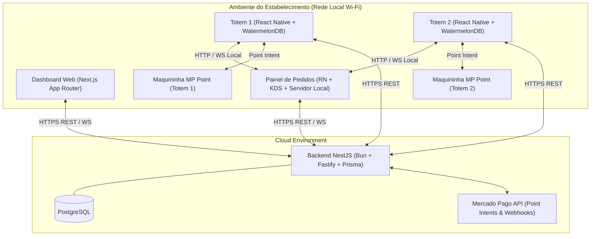
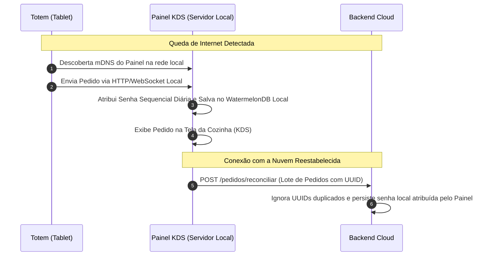

# Arquitetura Técnica — TotemOS (v1)

Visão geral da topologia de rede, fluxos de dados e estratégias de resiliência offline do ecossistema TotemOS.

## Delimitação do roadmap em 29/10/2026

Este documento preserva a arquitetura histórica de intenção. Os diagramas e
fluxos Point/LAN/WS/reconciliação abaixo **não descrevem recursos entregues**.
Na base `ef20663`, criação de pedidos, snapshots, senha nullable e pareamento
existem; pagamento, emissão de senha, fila operacional e transições ainda não.

O [roadmap](https://trello.com/c/iKSJ1R4J) define P0 cloud-online, com backend
e PostgreSQL persistentes, e liberação DEMO protegida sem cobrança; P1 mesas;
P2 provider financeiro de teste; Point física, impressão, LAN e offline pós-MVP.
O [spike LAN #19](spikes/kds-local-network.md) permanece INCONCLUSIVO.

Contrato atual auditado, propostas e conflitos com regras globais:
[ADR 0001, PROPOSTA](adr/0001-contrato-operacional-p0.md) e
[matriz de divergências](contrato-operacional-divergencias.md).
Solicitação KDS com numeração atômica no backend aguarda revisão do Caio;
não altera automaticamente a regra global histórica.

---

## 1. Topologia histórica proposta, não implementada integralmente

---

## 2. Fluxo futuro com Point física, não implementado

1. **Seleção e Intent**: O cliente escolhe os itens no **Totem 1** e solicita o pagamento.
2. **Intent Point**: O **Totem 1** envia `POST /pagamentos/intent` para o **Backend Cloud**.
3. **Acionamento da Maquininha**: O **Backend Cloud** se comunica com a API do Mercado Pago Point, que aciona a **Maquininha MP Point 1**.
4. **Pagamento pelo Cliente**: O cliente insere/aproxima o cartão ou paga via Pix no visor da maquininha.
5. **Webhook Assíncrono**: O Mercado Pago dispara um webhook para `POST /pagamentos/webhook/mercadopago`.
6. **Notificação em Tempo Real**: O **Backend Cloud** atualiza o pedido para `PENDENTE` e notifica o **Painel de Pedidos (KDS)** via WebSocket.
7. **Emissão de Senha**: O **Painel** recebe o pedido, atribui a senha sequencial do dia e o exibe na fila da cozinha.

---

## 3. Hipótese offline pós-MVP, não validada

---

## 4. Escopo histórico da v1, substituído pelo roadmap P0/P1/P2

### Intenção histórica, sem prova de implementação

- Isolamento estrito por `negocioId`.
- Atribuição de senha pelo Painel de Pedidos.
- Mapeamento 1:1 de Totem para Maquininha MP Point.
- Snapshot obrigatório de preços (`precoNoMomento`).
- Reconciliação em lote offline com UUID de idempotência.

### Exclusões históricas

- Planos e cobrança de SaaS ao lojista.
- Emissão fiscal (NFC-e / SAT).
- Impressoras térmicas dedicadas (impressão limitada à maquininha MP Point se disponível).
