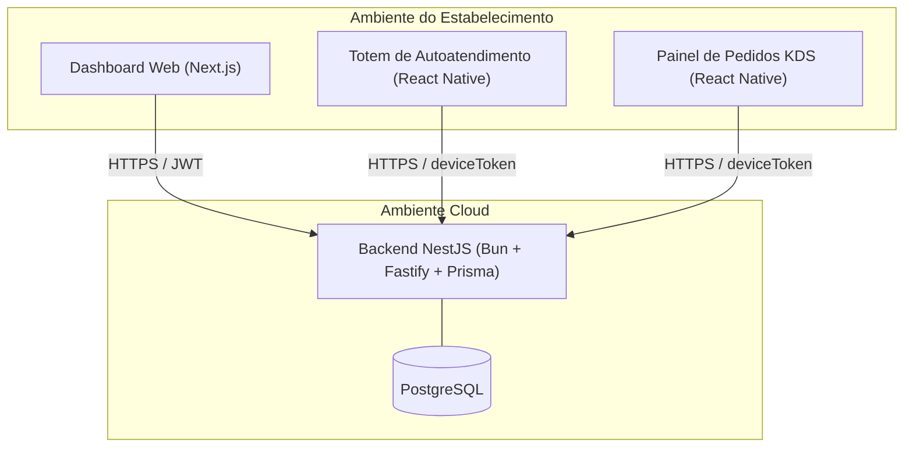
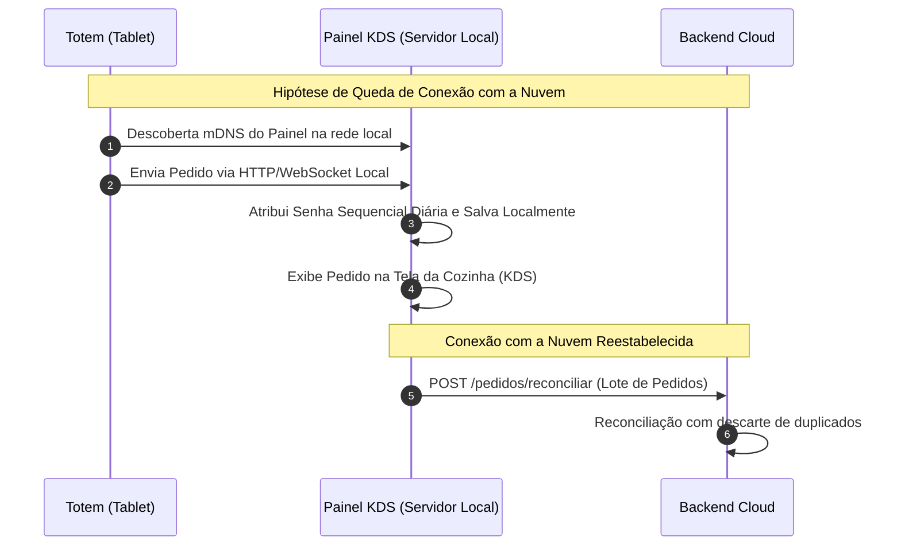
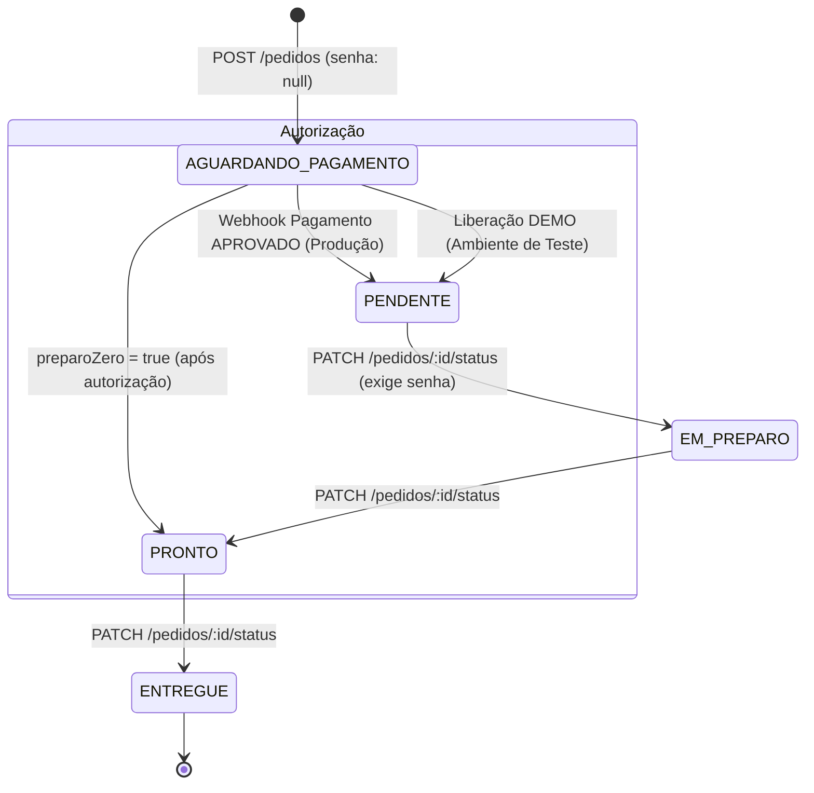

# Arquitetura Técnica — TotemOS (v1)

Visão geral da topologia de rede, fluxos de dados, separação de ambientes e delimitação de resiliência do ecossistema TotemOS.

---

## 1. Delimitação do Roadmap e Estado Atual

A arquitetura do TotemOS é orientada pelos marcos do roadmap oficial:

- **P0 (MVP Obrigatório, em consolidação)**: Arquitetura **estritamente cloud-online**. Totem, Painel de Pedidos (KDS) e Dashboard Web operam conectados à nuvem via HTTPS/WSS contra o Backend NestJS e banco de dados PostgreSQL persistente. Inclui pareamento criptográfico de dispositivos, catálogo digital, criação de pedidos com snapshots imutáveis, fila da cozinha, transições de status no KDS, emissão atômica de senha diária pelo backend e liberação operacional DEMO para testes de fluxo sem transação financeira.
- **P1**: Atendimento e suporte a mesas.
- **P2**: Provedor de pagamento em ambiente sandbox (cartão mockado e Pix estático via API) sem maquininha física.
- **Pós-MVP**: Integração com maquininhas físicas Mercado Pago Point via Point Intent API, impressão térmica e sincronização offline em rede local.

---

## 2. Topologia do Sistema

### 2.1 Topologia Cloud-Online Efetiva (P0)

No P0, todos os clientes conectam-se diretamente ao backend centralizado:

- **Totem**: Consulta o catálogo público, cria pedidos com snapshots e acompanha o status mínimo do pedido criado.
- **Painel KDS**: Consulta a fila de pedidos autorizados, solicita a geração de senha diária e atualiza os status de preparo e entrega.
- **Dashboard Web**: Administração de catálogo, usuários e pareamento de novos dispositivos com controle de permissão por perfis (`DONO` e `GERENTE`).

---

### 2.2 Topologia Histórica Proposta e Hipótese Offline (Pós-MVP, Não Implementada)

A arquitetura inicial previa um servidor HTTP e WebSocket embutido no KDS Android para contingência em caso de queda de conexão à internet:

O experimento técnico avaliou essa arquitetura no [spike LAN #19](spikes/kds-local-network.md) e concluiu seu status como **INCONCLUSIVE**:
- Adapters nativos individuais (Nitro HTTP Server e Zeroconf mDNS) responderam adequadamente em hardware de teste.
- Contudo, a comunicação direta entre dois aparelhos Android físicos na mesma LAN não foi validada, e o fechamento voluntário de conexão WebSocket apresentou falha com código 1006.
- Portanto, essa topologia não integra o P0 e permanece como hipótese técnica pós-MVP.

---

## 3. Fluxos de Pagamento e Separação de Ambientes

O ciclo de vida de pedidos separa estritamente a autorização financeira da produção em cozinha:

### 3.1 Ambientes e Políticas de Pagamento

1. **Ambiente DEMO (Implementado no P0)**:
   - Destinado a testes e demonstrações de fluxo operacional sem dinheiro real.
   - Habilitado apenas em servidores onde `DEMO_ENVIRONMENT_ALLOWED=true`.
   - Executado via `POST /pedidos/:id/liberacao-demo` por usuário humano `DONO` com PIN de segurança.
   - Gera autorização puramente operacional sem registrar `Pagamento APROVADO` fictício.
2. **Ambiente Sandbox (Planejado para P2)**:
   - Integração com provedores de pagamento via API simulada (cartão de crédito mockado e Pix com confirmação assíncrona programada).
   - Não depende de maquininha física Point.
3. **Produção Real com Maquininha Point (Pós-MVP, Não Implementado)**:
   - O Totem solicitará `POST /pagamentos/intent` enviando o valor para a maquininha Mercado Pago Point associada.
   - O cliente efetuará o pagamento no visor do terminal físico.
   - O Mercado Pago enviará webhook assíncrono para `POST /pagamentos/webhook/mercadopago`.
   - Apenas após a confirmação criptográfica da assinatura do webhook o pedido será movido para `PENDENTE`.

---

## 4. Garantias e Princípios Arquiteturais Invioláveis

1. **Isolamento de Estabelecimento (`negocioId`)**: Toda entidade e consulta no banco de dados é vinculada ao identificador do tenant, derivado diretamente da autenticação.
2. **Snapshots Imutáveis de Preço**: O cliente nunca envia valores monetários. O backend consulta o catálogo, valida regras de adicionais e grava snapshots congelados (`precoNoMomento`).
3. **Idempotência**: Requisições de mutação aceitam e persistem a chave `X-Idempotency-Key`, assegurando reprocessamento seguro em falhas de rede.
4. **Autoridade de Senha no KDS**: A senha diária sequencial é gerada por solicitação autenticada do KDS e calculada atomicamente pelo backend no fuso horário `America/Sao_Paulo`.
5. **Segurança de Dispositivos**: Dispositivos utilizam `deviceToken` opaco com hash HMAC persistido. Dispositivos não possuem permissão para rotas administrativas de usuários humanos.
