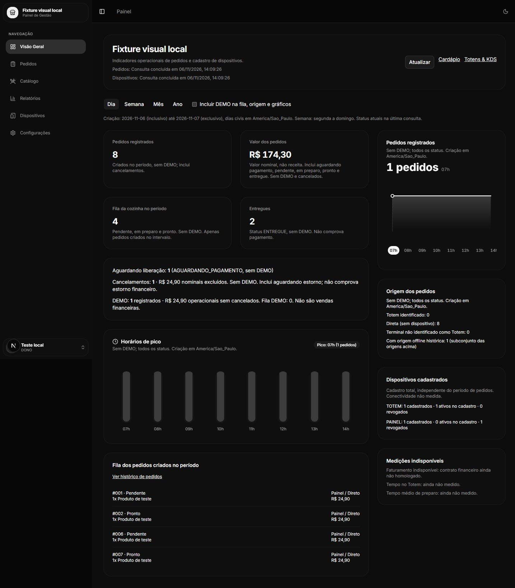
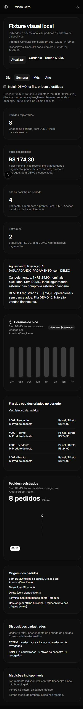

# Card #35: indicadores operacionais reais

Base: `e034c0f60821c19ddc5d4ef4eef1392d0c3681df`, branch
`feature/dashboard-indicadores-reais`. Auditoria anterior à implementação, 06/11/2026.
[Card](https://trello.com/c/5DYe4qyo).

## Auditoria inicial

Indicador | Fonte atual / classe | Problema | Fonte correta | Tratamento
--- | --- | --- | --- | ---
Nome do negócio | auth-context, A REAL | Nenhum | JWT humano / auth/me | Preservar
Vendas Hoje | calcularMetricasPedidos, D INCORRETO | Soma nominal sem aprovação financeira; dia UTC | createdAt e valorTotal persistidos | Valor dos pedidos, sem DEMO/cancelados
Crescimento vs ontem | literal 0%, D | Comparação inexistente | Dois períodos completos | Remover
Fila e lista | getPedidos + status, B DERIVÁVEL | Período e interpretação de fila precisam ser explícitos | PENDENTE/EM_PREPARO/PRONTO | Retrato dos status atuais de pedidos criados no período; separar DEMO
Tempo médio de preparo | estado 0, C INDISPONÍVEL | Sem eventos de início/fim | Telemetria futura | Ainda não medido
Tempo no Totem | literal 0s, C | Sem sessões/interações | Telemetria futura | Ainda não medido
Totens ativos/total | getDispositivos, A | Falha vira lista vazia; ativo não é online | Cadastro autenticado | Erro próprio; totais TOTEM/PAINEL, ativos/revogados
Operação Conectada / tempo real | texto fixo, D | Sem heartbeat ou conexão contínua | Timestamp de HTTP bem-sucedido | Timestamp por fonte, atualização manual e aviso de desatualização
Horários de pico | EMPTY_HOURLY_ORDERS, D | Horas arbitrárias, zeros e preenchimento mínimo | createdAt São Paulo | Buckets reais, empate pela primeira hora, vazio explícito
Spline faturamento | EMPTY_DATASETS, D | Pontos, unidades financeiras e períodos fictícios | Contagem por createdAt | Pedidos por hora/dia/mês
Meta/donut/crescimento spline | literais, C | Não há configuração ou comparativo | Contrato futuro | Remover
Senha, cliente, itens e valor da lista | snapshots do pedido, A | Senha não determina dia de criação | Pedido persistido | Helpers existentes, link para histórico de pedidos
Origem da lista | descreverOrigemPedido, B | Texto cloud online não mede presença | dispositivoId, cadastro e origemOffline | Distribuição identificável, sem inferir conectividade
Registrados/entregues/aguardando/cancelados/DEMO | não exibidos, B | Dados disponíveis | status e demo | Contagem separada
Faturamento/estornos financeiros | pagamentos opcionais, C | Point/webhook financeiro não homologado | Contrato financeiro futuro | Indisponível mesmo com status ENTREGUE ou registro APROVADO isolado

## Contratos auditados

`GET /pedidos`: controller limita humanos a DONO/GERENTE e usa negocioId do JWT;
service usa findMany sem take, skip ou paginação, inclui itens e pagamentos.
Não há truncamento no código intermediário auditado. Filtros dataIniciadaEm e
dataFinalizadaEm usam **dataSequencial**, que pode ser reatribuída pelo KDS.
Portanto a visão geral consulta a lista completa, sem esses filtros, e filtra
createdAt localmente. Não usa dataOperacional, dataSequencial ou updatedAt para
agrupar criação. `/admin/pedidos` permanece com seu contrato anterior.

`GET /dispositivos`: cadastro tenant-scoped, sem telemetria. Nenhum guard alterado.
Sem novo backend, migrations, consultas ao banco operacional, deploy ou merge.
`/admin/relatorios` é uma tela estática legada fora deste card; o uso compartilhado
do spline precisa receber estado indisponível explícito para não regressar.

## Completude e limites

P0 usa a resposta integral do endpoint existente, sem polling. Não há garantia
de custo limitado para históricos grandes: findMany inclui snapshots e não tem
índice de criação por tenant dedicado. Falhas/timeout não são convertidos em
totais parciais. Não há benchmark de produção nem validação de proxies externos.
Antes de escalar o histórico, Caio deve revisar endpoint agregado por createdAt,
índice (negocioId, createdAt), projeção e testes PostgreSQL entre tenants.
Não é seguro aplicar o filtro atual para reduzir volume mantendo esta semântica.

## Definições implementadas

- Intervalo civil `[início, fim)` em America/Sao_Paulo, exibido na tela e ancorado
  na última consulta bem-sucedida. Dia atual, semana segunda a domingo, mês e ano
  atuais. Grupos usam somente createdAt. Intervalos não dependem do fuso do navegador.
- Registrados: quantidade comercial, todos os status. Entregues: ENTREGUE.
  Aguardando liberação: AGUARDANDO_PAGAMENTO. Cancelamentos: CANCELADO e
  CANCELADO_AGUARDANDO_ESTORNO. Contagens DEMO separadas.
- Fila: PENDENTE/EM_PREPARO/PRONTO criados no período. Não é backlog global ou
  autorização operacional inferida. Inclui DEMO somente pelo checkbox. Lista
  mostra no máximo 20, informa o total e aponta para `/admin/pedidos`.
- Valor dos pedidos: `sum(round(valorTotal * 100))/100`, sem DEMO e sem ambos os
  cancelamentos. Inclui AGUARDANDO_PAGAMENTO/PENDENTE/EM_PREPARO/PRONTO/ENTREGUE.
  Usa snapshots do servidor, sem catálogo, sem interpretar pagamento. Soma de
  cancelados apresentada separadamente. Dinheiro negativo, não finito, com
  precisão além de centavos ou soma não segura é rejeitado.
- DEMO: contagem completa, valor nominal operacional sem cancelados, fila
  separada. Não compõe valor comercial. Checkbox só afeta fila/origem/gráficos.
- Faturamento é `null`, não zero. Registros opcionais de pagamentos e um status
  APROVADO isolado não oferecem contrato homologado de deduplicação, competência
  financeira e estornos. A auditoria de src não encontrou serviço gravando
  pagamento APROVADO produtivo. Não implementamos financeiro neste card.
- Gráficos contam todos os status conforme filtro DEMO. Barras mostram apenas
  horas com pedidos; altura = quantidade/máximo, empate pela hora mais cedo.
  Spline: horas no dia, dias na semana/mês, meses no ano. Lacunas entre primeiro
  e último bucket observado têm zero calculado a partir da resposta completa,
  preservando espaçamento temporal. Sem registros não gera atividade, SVG ou meta.
- Origem: TOTEM apenas quando identificado na relação/cadastro; sem dispositivo
  é direta; restantes são terminais não identificados como TOTEM. Offline é um
  subconjunto histórico, não presença atual. Usa helper de origem na lista, sem
  renderizar sua descrição legada de conectividade.
- Cadastro: total, ativo sem revogadoEm e revogado por tipo TOTEM/PAINEL.
  Faturamento, conectividade, metas, comparações e tempos continuam indisponíveis.
- Fontes independentes; falha não vira lista vazia. Último snapshot retido com
  aviso durante atualização, em falha ou após cinco minutos; timestamp por fonte.
  Timeout 20 s e cancelamento por AbortSignal. Versão impede resposta antiga.
  401/403 apagam ambas as fontes; 401 oferece logout e novo login. Identidade,
  tenant ou token diferentes remontam a consulta, sem cache global/local de métricas.

## TDD e validação local

Executado em Windows, Bun 1.4.4, Next.js 16.2.6, em 06/11/2026.

Etapa | Evidência
--- | ---
RED agregação | `bun test test/indicadores.test.ts`: módulo indicadores inexistente, 1 falha
GREEN agregação inicial | 28 testes aprovados
RED consulta | `bun test test/indicadores-consulta.test.ts`: módulo inexistente, 1 falha
GREEN consulta inicial | 8 testes aprovados
RED lacunas temporais | 29 passaram e 1 falhou: série omitia bucket intermediário vazio
GREEN lacunas temporais | Bucket intermediário preenchido com zero medido
RED loading do spline | 7 passaram e 1 falhou: loading mostrava indisponibilidade prematura
GREEN loading | Skeleton até conclusão da consulta, 8 testes DOM aprovados
Suíte completa final | `bun test`: **60 pass, 0 fail**, 6 arquivos, 129 expect calls
Lint | `bun run lint`: exit 0, sem erros ou warnings
TypeScript | `bun run typecheck`: exit 0
Build | `bun run build`: exit 0, 12 páginas geradas, `/admin` incluída
Formatação | `bunx prettier --check` nos arquivos TS/TSX alterados: todos conformes
Diff | `git diff --check`: exit 0

Os 60 testes incluem as 13 regressões de catálogo/dispositivos/pedidos do #34 e
47 cenários novos: agregação, dinheiro, dias/semana/mês/ano, limites de meia-noite,
ano bissexto, origem, cadastro, coordenadas 0/1/2/iguais/1000 pontos, interação
hover/seleção/foco, refetch, troca DEMO/período/sessão, dois tenants, snapshots,
erros 401/403/429/503, timeout e respostas fora de ordem. Os testes existentes
receberam somente adaptação de tipagem dos mocks de fetch para preservar
preconnect dos tipos do Bun. happy-dom é dependência exclusiva de testes.

`bun install --frozen-lockfile` funcionou na preparação. Não havia lockfile
versionado: o repositório ignora bun.lock, e a instalação limpa resolveu as
dependências. Não se alega reprodutibilidade de versões transitivas.

Microbenchmark sintético em memória: 10.000 pedidos, agregação anual, **59 ms**,
valor nominal esperado 101000. Não mede consulta PostgreSQL, rede ou proxy.

## Conferência visual e limites da homologação

Skill `verification`: história verificada da visão geral autenticada → API HTTP
de fixture local → normalização → agregação → renderização. Servidor Next
respondeu `/admin` 200; console do navegador sem erros/warnings. Período Semana
mudou para 02/11/2026 inclusivo a 09/11/2026 exclusivo. Mobile: largura do
documento e do conteúdo **390 px**, sem overflow horizontal. Servidores de teste
encerrados após conferência; nenhuma fixture entrou no código do produto.

As imagens usam **dados artificiais de teste e identidade local sem validade**.
Não são evidência de pagamentos, PostgreSQL real ou operação de equipamentos.

Não alteramos backend; integração PostgreSQL será verificada pelos jobs existentes
da CI. Homologação com usuários, Android, pagamentos, hardware, histórico de grande
volume e ambiente DEMO isolado permanece no card #41 e na revisão humana.
Não houve deploy, merge ou migration. CI dos quatro apps será acompanhada no PR.

## Revisão de finalização, 06/11/2026

Revisão do HEAD inicial `bcd31fe16fb73334a94cf8e6be4d05c862db9188`.
O fetch confirmou develop ainda em `e034c0f`, PR #23 aberto, sem conflitos,
sem threads de revisão e com os quatro jobs da execução
[42259783665](https://github.com/GabrielNito/TotemOS/actions/runs/42259783665)
aprovados nesse HEAD. API de proteção retornou "Branch not protected";
regras efetivas/rulesets vazios e nenhum revisor solicitado no GitHub.
O registro do card em Code Review & CI informa aprovação humana final pendente;
ausência de proteção automática não substitui essa aprovação.

### Bugs reproduzidos e correção mínima

Severidade | Problema | RED | GREEN
--- | --- | --- | ---
P1 | Promise.allSettled mantinha os snapshots após um 401/403 já conhecido enquanto a outra fonte continuava pendente | Quatro testes, 401/403 em cada fonte, ainda encontraram dados no snapshot | Negação da requisição vigente limpa ambas as fontes imediatamente, cancela o transporte e invalida a geração; conclusão tardia não repopula os dados
P2 | Timestamp de pedidos era atribuído ao concluir a fonte mais lenta; podia mudar o dia de referência indevidamente | Teste com pedidos concluídos e dispositivos demorados encontrou timestamp posterior | Timestamp capturado individualmente ao concluir cada fonte com sucesso

Os cinco testes falharam antes de alterar a implementação, com **9 pass / 5 fail**
na suíte de consulta. Após a correção passaram; também foi verificado que 401
tardio de requisição substituída não apaga o snapshot recente. A coordenação
continua usando allSettled para erros parciais comuns, com invalidação antecipada
apenas para negação de acesso. Sem mudança de fórmulas, API ou design.

Os 60 testes anteriores foram reexecutados com sucesso antes da correção.
Suíte final: **68 pass / 0 fail**, 6 arquivos, 160 expect calls. Oito cenários
adicionados: cinco RED/GREEN acima, 401 obsoleto, virada de ano na UI e histórico
de dez mil pedidos. Lint sem erros/warnings, typecheck, Prettier dos 12 arquivos
TS/TSX da entrega, build Next 16.2.6 e git diff --check aprovados novamente.

### Resultado das demais verificações

Contagens e valores seguem as definições acima, inclusive ambos os cancelamentos,
DEMO fora do valor comercial e pagamento pendente/ENTREGUE sem receita inferida.
JWT humano e escopo do servidor preservados. Chave da visão geral inclui tenant,
identidade e token; unmount cancela a geração. Dados cruzados entre tenants são
rejeitados; não há cache global de métricas. Dependências novas são somente de
desenvolvimento. CI adiciona execução dos testes sem remover verificações.
Nos testes antigos, os mocks preservam preconnect e as asserções de domínio.

Virada de dia/ano com o Dashboard aberto foi exercitada no DOM: consulta às
02:59Z de 01/01 corresponde a 31/12 em São Paulo. Após 03:01Z, alternar filtros
preserva o calendário do snapshot; Atualizar muda explicitamente para 01/01.
Esse comportamento mantém a semântica documentada, sem polling ou números
reclassificados como recentes. Capturas desktop/mobile existentes continuam
sendo apenas fixtures HTTP, sem prova de PostgreSQL, financeiro ou equipamentos.

### Avaliação objetiva de escala e recomendação ao Caio

Benchmark sintético adicional, com registros mínimos, itens vazios e criação
distribuída nos doze meses, sem medir banco, parsing ou tráfego:

Pedidos | JSON serializado | Agregação | Contagem / valor nominal
--- | --- | --- | ---
10.000 | 2,2 MiB | 68 ms | 10.000 / 101000
50.000 | 11,2 MiB | 307 ms | 50.000 / 505000
100.000 | 22,5 MiB | 583 ms | 100.000 / 1010000

São medições locais, não metas de latência nem garantia para mobile. Objetos
normalizados, snapshots e arrays intermediários usam memória adicional; o
trabalho síncrono pode pausar a UI conforme o histórico cresce. A validação
inicial e uma troca de filtro podem repetir agregações. Teste funcional com
10.000 pedidos confirmou quantidade, soma em centavos e total da série.

O findMany não limita linhas nem trunca a lista. Resposta HTTP/JSON incompleta
produz erro; não há aproveitamento de linhas parciais como total. Há, porém,
limite externo real: a documentação da
[Vercel Functions](https://vercel.com/docs/functions/limitations#request-body-size)
informa 4,5 MB para corpo de resposta, pertinente ao adaptador Node em
apps/backend/vercel.json. Snapshots podem atingir esse teto muito antes dos
volumes mínimos acima. Não foi reproduzida uma resposta grande na plataforma;
não existe aqui um número seguro universal de pedidos nem validação de proxy.

Parecer de escala: aceitável para o P0 de volume inicial limitado, com
indisponibilidade explícita em falha; não é solução para histórico indefinido.
Não exige reescrever o card nem criar endpoint neste PR. Antes de ampliar o uso,
Caio deve revisar agregação tenant-scoped por createdAt, projeção sem itens e
pagamentos desnecessários, índice (negocioId, createdAt), limite de payload,
benchmark PostgreSQL/rede e testes entre tenants. Os filtros atuais por
dataSequencial não podem ser usados como atalho. Homologação integrada segue #41.

Nenhum backend, banco operacional, migration, Totem ou KDS foi alterado nesta
revisão. Nenhum comando de deploy executado; a integração Vercel existente
publica previews automaticamente ao receber pushes, conforme comentário do bot
no PR. Previews não são homologação ou promoção manual de produção.
