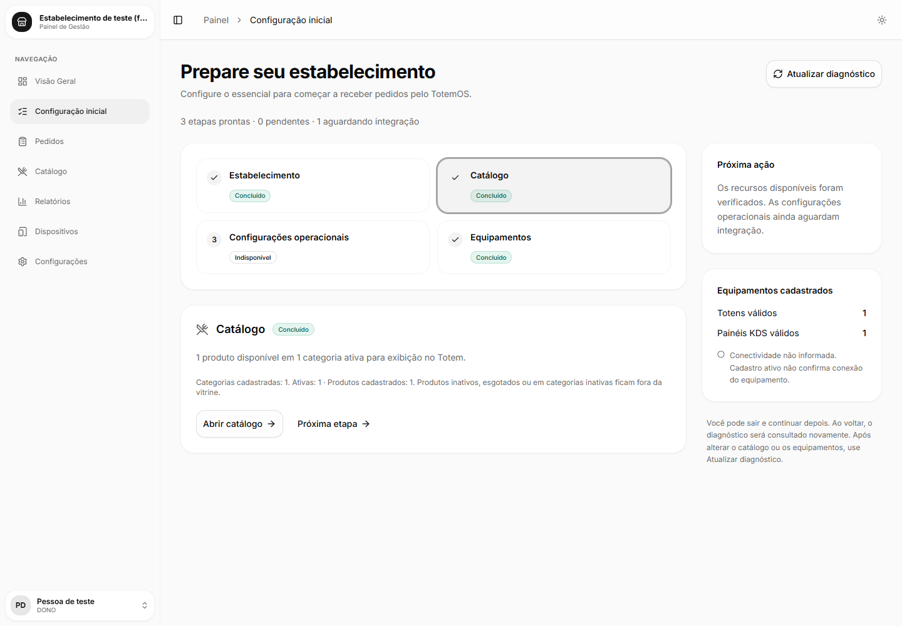
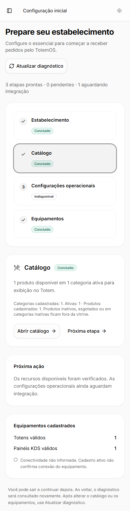

# Primeira configuração operacional, card #38

Implementação de 06/11/2026, branch `feature/dashboard-setup-wizard`, baseada em
`origin/develop` `6e5dbf302c23535426aa2196e5de5811ab78dab0` após `git fetch origin`.
Worktree separado; alterações locais anteriores e outras branches preservadas.

## Auditoria e dependências

Lidos AGENTS global/Dashboard, CONTRIBUTING, DESIGN, Dashboard-SPEC e Backend-SPEC.
Auditados layout/visão geral admin, catálogo, dispositivos, configurações,
cliente HTTP, modelos, contexto de autenticação e sidebar. Consultada a
documentação Next.js 16.2.6 local de layouts/pages e server/client components.

Trello consultado novamente em 06/11/2026: [#36](https://trello.com/c/HS95JVaq)
e [#37](https://trello.com/c/0nXyMoFp) continuam no Backlog, sob Caio. Busca de
PRs no GitHub e inspeção da develop confirmam ausência do contrato administrativo
integrado de NegocioConfig. `/admin/configuracoes` ainda simula persistência.
O wizard não importa esses handlers, não aponta para essa tela e não afirma
sincronização com Totens. [#38](https://trello.com/c/alj6WGQj) permanece incompleto,
em progresso, aguardando integração e revisão do PR.

Nenhum contrato novo é necessário para o diagnóstico parcial. Não houve alteração
no card #36 nem envio de mensagens a Caio; as dependências ficam no PR para revisão.

## Etapas e critérios

| Etapa | Fonte | Critério |
| --- | --- | --- |
| Estabelecimento | Sessão validada por `/auth/me`, login ou registro | Conta DONO/GERENTE e negócio identificado; nome real, perfil e negocioId sem edição |
| Catálogo | `GET /catalogo/admin` | Produto ativo, não esgotado, em categoria ativa, conforme regra compartilhada da vitrine |
| Configurações operacionais | Indisponível | Identificação, preparo e boas-vindas dependem de #36/#37, sem defaults como prova |
| Equipamentos | `GET /dispositivos` | Pelo menos um TOTEM e um PAINEL ativos com revogadoEm nulo |

O contrato público e `filtrarCatalogoPublico` usam categoria ativa, produto ativo
e esgotado=false. Não exigem imagem, adicionais ou tipo de estabelecimento.
O administrativo não inclui variações; o contrato público filtra variações
esgotadas mantendo o produto base visível. O wizard segue esse contrato.
Categoria vazia, produto inativo, esgotado ou oculto não representam prontidão.

Concluído, pendente, indisponível, carregando e erro ficam separados. O resumo
discrimina quatro etapas, sem percentual ou conclusão global. Visitar uma etapa
não conclui nada. Indisponibilidade de integração não é falha do operador.
Próxima ação aponta à primeira pendência/erro ou informa a dependência restante.

## Consultas, segurança e retomada

- JWT humano explícito nos endpoints existentes e cache no-store. Sem negocioId
  em URL/body ou credenciais de dispositivo. Backend mantém autorização
  tenant-scoped; conferência local adicional rejeita entidades de outro tenant.
- Fontes paralelas publicadas independentemente. Falha no catálogo não impede
  equipamentos e vice-versa. Erro não vira vazio, pendência ou confirmação antiga.
- Refetch limpa a conclusão antiga enquanto consulta. Retomada monta nova
  instância, reconhecendo recursos criados fora do wizard, esgotamento e revogação.
- Timeout 20 s, abort ao desmontar/atualizar e versão contra respostas antigas.
  Corrida de cancelamento termina mesmo se o transporte ignora AbortSignal.
- Chave por usuário/tenant/token remove snapshots antigos. Respostas após troca
  de token são descartadas. Sessão em validação não mostra dados do cache.
- 401 invalida ambas as fontes e segue logout existente; 403 também remove dados.
  403 oferece Trocar conta com logout antes do login, evitando redirecionamento
  pelo cookie ainda existente. 404, 429, 503, rede e timeout têm mensagens seguras e tentativa manual.
  Não exibe nem registra mensagem arbitrária do servidor.
- Sem polling ou gravação de progresso, PIN, token ou códigos em logs/evidências.
  `totemos_user` é cache de sessão preexistente; o assistente não cria chave local.
- Pareamento permanece em `/admin/dispositivos`, com geração pelo DONO. Cadastro
  válido não comprova conectividade. Não há heartbeat ou comando remoto.

## TDD e validação

| Verificação | Resultado |
| --- | --- |
| RED regras/consulta | `bun test test/configuracao-inicial.test.ts`: módulo ainda inexistente |
| GREEN inicial | 26 testes aprovados |
| RED interface | `bun test test/configuracao-inicial-ui.test.tsx`: página ainda inexistente |
| GREEN interface | 4 testes DOM aprovados, happy-dom/React act existentes |
| RED texto natural | 1 falha, 3 pass: plural da contagem ainda usava `(s)` |
| RED contraste | axe-core detectou contraste 4,4:1 no badge da etapa selecionada |
| GREEN contraste | Texto verde escurecido; zero violações automáticas no conteúdo principal |
| RED troca de conta | 4 pass, 1 fail: faltava encerrar sessão após 403 antes de abrir login |
| GREEN final do card | 34 testes, incluindo troca de token/conta, payload cruzado e recuperação |
| Suíte completa Dashboard | 121 pass, 0 fail, 10 arquivos, 257 expect calls |
| Lint | `bun run lint`: exit 0, sem erros/warnings |
| Tipagem | `bun run typecheck`: exit 0 |
| Build | `bun run build`: 13 páginas, inclui a nova rota |
| Prettier | `bunx prettier --check` nos sete arquivos TS/TSX alterados: conforme |
| Diff | `git diff --check`: exit 0 |

Windows, Bun 1.4.4, Next.js 16.2.6. `bun install --frozen-lockfile` executado;
não havia lockfile versionado. A instalação avisou sobre suporte da versão
ESLint 9 existente; lint/build não emitiram warnings. Nenhuma biblioteca adicionada
ao app. Playwright/axe-core usados em diretório temporário externo, sem alterar
manifests ou dependências do repositório.

## Navegador e capturas de teste

Build servido localmente por `bun run start -- --port 3120`, Chromium headless
com Playwright. Respostas HTTP de `/auth/me`, `/catalogo/admin` e `/dispositivos`
interceptadas localmente com fixture explicitamente de teste. Não é evidência
de backend operacional, autenticação real ou equipamento Android.

| Checagem | Desktop | Mobile |
| --- | --- | --- |
| Viewport | 1440×1000 | 390×844 |
| Overflow horizontal | Ausente | Ausente |
| Foco e Enter selecionam etapa | Passou | Passou |
| axe-core, WCAG 2 A/AA e 2.1 AA no main | 0 violações | 0 violações |
| `/admin/catalogo` e `/admin/dispositivos` | HTTP 200 | HTTP 200 |
| Erro parcial 503 | Preserva catálogo | Preserva catálogo |
| Refetch com produto esgotado | Vira pendência | Vira pendência |
| Mutações do wizard | Nenhuma, apenas GET | Nenhuma, apenas GET |

Resultados: [browser-verification.json](browser-verification.json). Sem exceções
JavaScript; único erro de console foi o HTTP 503 provocado pelo teste negativo.
Layout inspecionado nas capturas. Etapas usam botões nativos, foco visível,
aria-pressed/aria-controls e status textual independente de cor.

## Limites de aceite e homologação

O ponto `configuracaoOperacional` em `lib/configuracao-inicial.ts` deverá consumir
leitura/validação real quando #36/#37 forem integrados. Não há teste de configuração
real porque o contrato não existe na base auditada. #38 não pode ser marcado
concluído pelo merge deste frontend parcial.

[#41](https://trello.com/c/6JbgEgg4) mantém homologação integrada: backend isolado,
duas sessões/tenants reais, NegocioConfig persistido, pareamento físico, revogação
e disponibilidade no Totem/KDS Android. Leitor de tela e equipamentos físicos
não foram homologados pelas fixtures.

Sem backend alterado, deploy, migrations, acesso ao Neon operacional, alterações
em main, pagamentos, provisionamento remoto ou merge automático. CI dos quatro
apps será verificada no PR; resultado remoto consta no relatório final/GitHub.
